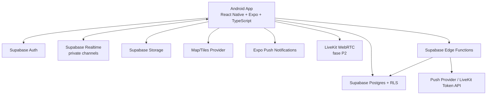

# Technical Architecture

## 1. Arsitektur ringkas



Prinsip: aplikasi mobile tidak menyimpan secret layanan. Perubahan yang melibatkan role, pembuatan token voice, moderasi, atau operasi multi-tabel harus divalidasi server-side melalui Edge Functions/RPC yang aman.

## 2. Stack rekomendasi

| Layer | Pilihan awal | Catatan |
|---|---|---|
| Mobile | React Native + Expo + TypeScript | Android-first; dependency dipasang dengan `npx expo install` jika didukung Expo. |
| Routing screen | Expo Router | Pisahkan route dari domain state. |
| Server-state/cache | TanStack Query atau fetch layer typed sederhana | Pilih satu pola; jangan menambah library tanpa manfaat nyata. |
| UI state lokal | React hooks; Zustand hanya bila state lintas layar memang dibutuhkan | Hindari state global untuk setiap komponen. |
| Forms/validation | React Hook Form + Zod, bila sudah diperlukan | Validasi UI bukan pengganti validasi server. |
| Backend | Supabase Auth, Postgres, RLS, Realtime, Storage, Edge Functions | Selalu uji RLS dari sisi user, bukan hanya service role. |
| Peta | Evaluasi `react-native-maps` atau MapLibre React Native | Pilih setelah uji peta, routing, tiles, lisensi dan API key. Native maps memerlukan build yang sesuai; MapLibre tidak tersedia dalam Expo Go. |
| Lokasi | `expo-location` + `expo-task-manager` | Background behavior wajib dites di development build dan perangkat nyata. |
| Push | `expo-notifications` | Periksa kembali persyaratan build dan kredensial push untuk SDK yang dipilih. |
| Media foto | Supabase Storage | Tiga bucket privat (`vehicle-photos`, `club-logos`, `avatars`); perkecil + kompres di perangkat sebelum unggah, validasi ukuran/tipe, ownership lewat path + policy, signed URL berumur pendek, dan hapus file yatim. |
| Voice PTT | LiveKit React Native / Expo quickstart | Fase P2; token room dibuat backend. Jalankan development build karena native WebRTC. |
| Musik lokal | `expo-audio` + API media yang sesuai | Fase P2; uji audio focus, izin file, background playback dan konflik dengan PTT. |
| Build/test Android | Runner GitHub sendiri: `expo prebuild` + Gradle (ADR-051) | `eas.json` tetap ada sebagai profil, tetapi rilis APK tidak memakai EAS Cloud: `.github/workflows/release-on-push.yml` dan `android-release.yml` membangun di runner, lalu menjalankan `verify-apk` dan smoke test emulator. Konsekuensinya tidak ada kuota build pihak ketiga, tetapi waktu build memakai menit runner. |

### Peraturan memilih peta

Jangan memakai demo tiles untuk produksi. Pilih provider yang secara jelas mengizinkan penggunaan komersial, cache, atribusi, batas request, dan jenis aplikasi ini. Petakan biaya per pengguna aktif dan frekuensi pan/zoom. Routing/navigation turn-by-turn dianggap integrasi terpisah dari menampilkan peta.

### Peraturan dependency

- Verifikasi panduan kompatibilitas SDK saat instalasi.
- Jangan memasang library native penting lalu mengasumsikan Expo Go dapat menjalankannya.
- Setelah mengubah native dependency atau app config, buat ulang development build.
- Pin versi melalui lockfile dan lakukan upgrade secara terencana; jangan mengupdate semua dependency di tengah pengerjaan fitur.

## 3. Layer aplikasi

Target struktur (folder bertanda P1/P2 belum ada):

```text
src/
  app/                     # route/screen Expo Router
  components/              # komponen presentasional bersama
  features/
    auth/
    profile/
    garage/
    clubs/
    rides/
    live-location/
    hazards/
    convoy-chat/
    feed/                  # P1
    voice/                 # P2
    music/                 # P2
    notifications/
  lib/
    supabase/
    permissions/
    maps/
    analytics/
  services/                # wrapper API typed
  hooks/
  types/
  constants/
  utils/
supabase/
  migrations/
  functions/
docs/
```

Keadaan sebenarnya per 29 Oktober 2026 (`ls src/features`): `auth`, `chat`, `clubs`, `garage`,
`hazards`, `map`, `media`, `moderation`, `profile`, `rides`. Tidak ada `services/` terpisah —
wrapper API tinggal di `features/<domain>/api.ts`. `supabase/functions/` kini berisi
`delete-account` (Milestone 5, ADR-077); yang **belum ada** adalah Edge Function pengirim
notifikasi M5 (ADR-075, statusnya masih Proposed).

Aturan dependency: screen memanggil feature hook/service, service memanggil Supabase/client/native API. Komponen presentasional tidak memuat query database atau aturan akses. Tipe database dihasilkan dari schema/migration bila workflow Supabase CLI digunakan.

## 4. Pola live location

### Lifecycle

1. Pengguna bergabung ke ride.
2. Creator mengubah status ride ke `active`.
3. Aplikasi menjelaskan permission; meminta foreground permission dahulu.
4. Jika pengguna setuju dan background sharing diperlukan, minta izin tambahan secara kontekstual.
5. Aplikasi mendaftar location task pada top-level module sesuai kebutuhan Expo Location/Task Manager.
6. Untuk setiap update, lakukan validasi lokal sederhana (timestamp, accuracy, jarak loncatan tidak wajar), kirim event ke private ride channel, dan simpan posisi terakhir secara hemat.
7. Penerima memperbarui marker peserta yang tepat tanpa merender ulang seluruh peta.
8. Saat sharing berhenti, user keluar, ride berakhir, atau permission dicabut, hentikan task/channel dan ubah status.

### Rate awal untuk pengujian

- Bergerak: update sekitar tiap 5 detik atau setiap ~20 meter, mana yang lebih dulu.
- Diam: update sekitar tiap 15 detik atau event perubahan status yang penting.
- Penerima menganggap lokasi stale setelah 20-30 detik tanpa update, dengan nilai yang diuji.
- Persistensi database dibatasi; misalnya hanya posisi terakhir dan timestamp, dengan update tidak setiap GPS sample bila tidak dibutuhkan.

Parameter ini bukan konstanta final. Ukur akurasi, penggunaan baterai, data, load Realtime, dan pengalaman di jaringan seluler sebelum release.

### Stale/offline states

- `live`: update baru dalam ambang waktu.
- `stale`: data sudah melewati ambang waktu; tampilkan umur data.
- `offline`: channel terputus atau perangkat tidak terhubung bila status dapat dipastikan.
- `location_unavailable`: izin/GPS tidak tersedia atau error.
- `sharing_paused`: pengguna memilih berhenti sementara.

Jangan menampilkan marker diam tanpa indikator waktu, sebab pengguna bisa menyimpulkan peserta masih berada di sana.

## 5. Pola Supabase Realtime

- Gunakan private channel berbasis ride, contohnya `ride:<ride_uuid>:locations` dan `ride:<ride_uuid>:chat`. **Keadaan sekarang:** implementasi M3/M4 memakai **Postgres Changes** (`chat_messages`, `ride_locations`) karena setiap baris tetap melewati RLS dan policy `realtime.messages` tidak bisa dibuat dari koneksi migration (ADR-065/ADR-066). Broadcast tetap target untuk frekuensi tinggi (lokasi) setelah policy realtime tersedia.
- Channel join harus diotorisasi berdasarkan membership ride yang aktif. Validasi ini harus dilakukan lewat RLS authorization Realtime dan diuji dengan token non-member.
- Supabase merekomendasikan Broadcast untuk pola yang lebih scalable dibandingkan mengirim setiap sample melalui Postgres Changes. Simpan payload minimal.
- Pesan chat disimpan di tabel sebagai source of truth; Realtime dipakai untuk memberi notifikasi data baru. Untuk lokasi, Broadcast membawa update cepat; tabel `ride_locations` dapat menyimpan posisi terakhir yang diperlukan untuk initial state/reconnect.
- Patuhi batas message rate, ukuran payload, reconnect, timeout, dan error event SDK; jangan menganggap subscribe berarti connected sampai status channel menyatakan sukses.

### Contoh payload lokasi

```json
{
  "userId": "<uuid>",
  "rideId": "<uuid>",
  "lat": -6.200000,
  "lng": 106.816666,
  "accuracyM": 12,
  "headingDeg": 175,
  "speedMps": 8.4,
  "recordedAt": "2026-10-12T08:15:00Z"
}
```

Payload contoh; gunakan koordinat fiktif untuk dokumentasi dan log. Jangan tulis lokasi presisi ke analitik umum atau crash logs.

## 5a. Pola hapus akun (ADR-077)

- **Satu jalur tulis:** Edge Function `delete-account` adalah satu-satunya tempat yang boleh menghapus identitas login. Klien mengirim JWT; target diambil dari `auth.getUser(token)`, bukan body.
- **Urutan tidak boleh ditukar:** manifest media → pindahkan logo klub yang masih dipakai → hapus media pribadi → `purge_account_data()` (satu transaksi database) → Auth Admin API → tandai job selesai. Auth tidak boleh dihapus selama objek Storage pengguna masih ada.
- **Retry idempoten:** `account_deletion_jobs` menyimpan langkah terakhir yang selesai; kegagalan parsial mengembalikan error, bukan sukses. Job yang sudah `completed` dikembalikan tanpa menjalankan ulang.
- **Konten bersama:** laporan bahaya dan audit dipertahankan dengan `reporter_id`/`actor_id` = tombstone; pesan/postingan diredaksi; kepemilikan klub/perjalanan dialihkan. Jangan menambah FK baru ke `auth.users` atau mengembalikan cascade ke profil.
- **Batas:** access token lama tetap valid secara kriptografis sampai kedaluwarsa, tetapi tidak menemukan profil/baris miliknya; jangan menganggap `signOut()` klien sebagai pengganti penghapusan server.

## 6. Pola voice room PTT

- Gunakan layanan WebRTC audio (proof-of-concept LiveKit direkomendasikan untuk dievaluasi), bukan tabel/database untuk mengirim audio.
- Client meminta token melalui Edge Function setelah backend memverifikasi session, member/role, status ride, dan izin join.
- Token dibatasi pada room perjalanan yang benar; TTL dan kemampuan publish microphone sekecil mungkin.
- PTT harus memiliki state `connecting`, `connected`, `transmitting`, `muted`, `reconnecting`, `disconnected`, dan `error`.
- Uji Bluetooth/helmet intercom pada perangkat nyata. Dukungan input tombol fisik, screen-off, dan audio focus berbeda menurut perangkat/OS dan tidak boleh diasumsikan.
- Implementasikan di fase terpisah agar kegagalan voice tidak memblokir MVP keselamatan berbasis peta.

## 7. Push notification

- Simpan token perangkat per pengguna dan perangkat; perbarui ketika token berubah.
- Trigger notifikasi lewat backend/Edge Function, bukan membuka akses penulisan arbitrary notification dari client.
- Gunakan payload minimal. Arahkan pengguna ke entitas (ride/club/post) setelah aplikasi dibuka.
- Tangani permission ditolak, token kadaluwarsa, duplikasi, retry, dan preferensi notifikasi.

## 8. Environment variables dan rahasia

Contoh `.env.example`:

```dotenv
EXPO_PUBLIC_SUPABASE_URL=https://YOUR_PROJECT.supabase.co
EXPO_PUBLIC_SUPABASE_PUBLISHABLE_KEY=YOUR_PUBLIC_CLIENT_KEY
EXPO_PUBLIC_MAP_STYLE_URL=https://YOUR_TILE_PROVIDER/STYLE.json
```

Aturan:

- Nilai berprefix `EXPO_PUBLIC_` memang masuk ke bundle aplikasi; hanya tempatkan nilai yang aman untuk publik di sana.
- **Jangan pernah** menaruh Supabase service role key, LiveKit API secret, database password, private signing key, atau token admin di `.env` public mobile.
- Secret untuk Edge Functions dikelola dengan secret manager environment layanan.
- API key peta client-side wajib dibatasi sesuai aturan provider (application/package restrictions dan quota jika tersedia).
- `.env`, file credential, signing keystore, service-role key, dan token tidak boleh di-commit.

## 9. CI dan quality gates

Setiap perubahan sebaiknya menjalankan:

1. formatter/linter;
2. TypeScript `tsc --noEmit`;
3. unit tests untuk domain/service penting;
4. test SQL/RLS di test project — `npm run db:test` menjalankan **tujuh** berkas dari
   `DEFAULT_TEST_FILES`: profil & Storage (`rls_profiles_test.sql`), pagar katalog policy wadah
   (`rls_policy_guard_test.sql`: kepemilikan tanpa penjaga keanggotaan ⇒ CI gagal, ADR-060),
   perjalanan (`rls_rides_test.sql`), lalu empat berkas M4 (`rls_hazards_test.sql`,
   `rls_chat_test.sql`, `rls_moderation_m4_test.sql`, `rls_blocked_chat_test.sql`); setiap berkas
   harus memancarkan notice penandanya sendiri. `npm run db:types:check` membandingkan tipe hasil
   generate dengan skema yang sama;
5. smoke test pada development build Android;
6. EAS preview APK untuk milestone yang melibatkan native config.

Build production hanya dibuat setelah staging acceptance lulus dan versi dependency/credentials dikonfirmasi.

## 10. Keterbatasan dan trade-off

- Background location dapat dihentikan oleh OS, permission, battery saver, atau vendor; app harus mengkomunikasikan kondisi dan tidak menjanjikan tracking 100%.
- Expo Go cocok untuk memulai, tetapi bukan lingkungan final bagi seluruh native modules.
- Map tiles/routing/voice dapat memiliki biaya, batas kuota, dan lisensi sendiri.
- Push notification bukan transport real-time yang dijamin; data utama harus tetap di backend.
- Data GPS dari smartphone tidak setara dengan alat pelacak khusus.
