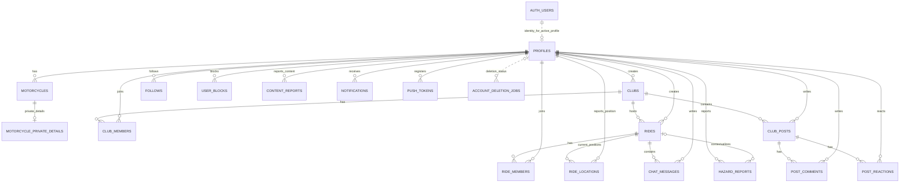

# Entity Relationship Diagram (ERD)

Diagram konseptual untuk membantu memahami domain data. Migration SQL adalah detail implementasi awal; diagram ini bukan pengganti pemeriksaan schema aktual.

## Catatan akses

- `profiles.id` **tidak** memiliki foreign key ke `auth.users` sejak ADR-077. Untuk akun aktif,
trigger memastikan baris profil hanya dibuat bila auth user dengan UUID yang sama ada; saat akun
dihapus, baris profil dihapus dan konten yang dipertahankan dialihkan ke tombstone bersama
`00000000-0000-4000-8000-000000000001`. Relasi di diagram karena itu putus-putus, bukan FK fisik.
- `account_deletion_jobs` menyimpan status orkestrasi (tanpa FK ke profil) agar retry tetap bisa
dilakukan setelah profil/auth user hilang. Hanya service role yang dapat membacanya.
- `profiles` berisi field profil yang aman saja; jangan menambahkan email atau data privat ke tabel ini tanpa meninjau RLS.
- `follows` menyimpan relasi terarah antar profil dengan kolom `status` (`pending`/`accepted`). Kolom itu diisi server: follow ke profil privat baru memberi akses baca setelah pemilik menyetujuinya (lihat ADR-039).
- `motorcycle_private_details` menyimpan plat nomor dan hanya dapat dibaca pemilik. Foreign key komposit `(motorcycle_id, owner_id) -> motorcycles(id, owner_id)` memastikan pemilik detail selalu pemilik kendaraan (ADR-040).
- `ride_locations` adalah posisi terakhir yang diperlukan selama ride aktif, bukan history trail default.
- Membership klub dan ride adalah sumber otorisasi untuk data privat.
- Voice room, media object storage, audit log, dan analytics provider dapat memiliki resource non-relasional tersendiri; secrets tidak pernah masuk tabel yang dibaca mobile.
